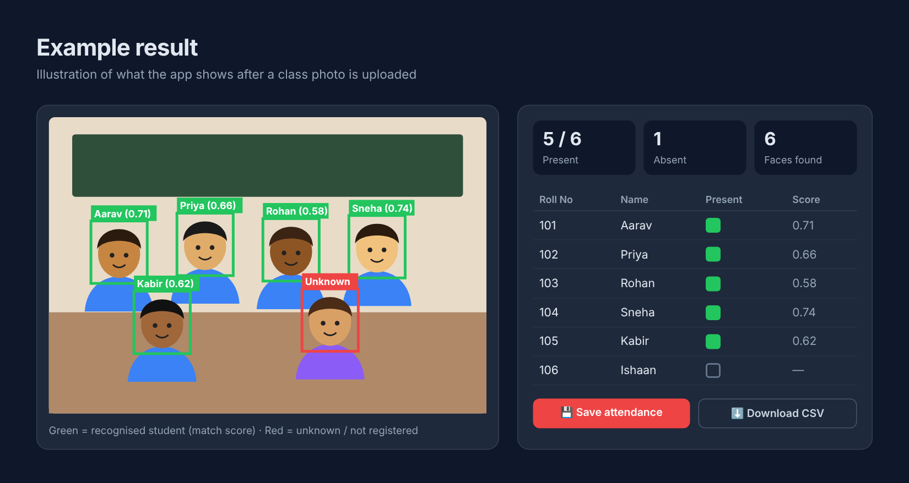
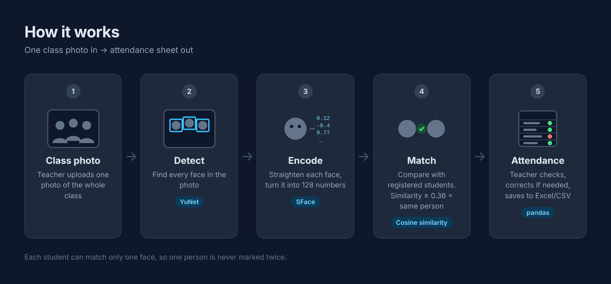

# 📸 Face Recognition Attendance System

Upload **one photo of the whole class** → the app finds every face, recognises the
registered students, and marks attendance. The teacher can correct mistakes and download it as Excel/CSV.



## Features

- Register students with 2–5 face photos each
- Take attendance from one or more class photos (for big classes, one photo per row)
- Green box = recognised student, red box = unknown face
- Tick/untick to correct mistakes before saving
- Download attendance as CSV (opens in Excel)
- Attendance % per student, with a warning below 75%
- Runs fully on your own computer, so no photos are sent to the internet

## How it works



| Step | What happens | Tool |
|---|---|---|
| 1. Detect | Find every face in the class photo | YuNet model (OpenCV) |
| 2. Encode | Straighten each face and turn it into 128 numbers (a "face encoding") | SFace model (OpenCV) |
| 3. Match | Compare with saved students using cosine similarity (≥ 0.36 = same person). Each student can match only one face | NumPy |
| 4. Save | Teacher checks the result and saves attendance | pandas |

## How to run

**Requirements:** Python 3.10–3.13 ([download](https://www.python.org/downloads/)). On Windows, tick **"Add Python to PATH"** while installing.

**1. Get the code.** On this page, click **Code → Download ZIP**, then right-click the zip → **Extract all**.
Or, with Git:
```
git clone https://github.com/sauravai006-commits/Student-Attendence.git
```

**2. Open a terminal in the project folder.** On Windows, open the folder in File Explorer,
click the address bar, type `cmd` and press Enter.

**3. Install the libraries** (only the first time):
```
python -m pip install -r requirements.txt
```

**4. Start the app:**
```
python -m streamlit run app.py
```
The app opens in your browser at `http://localhost:8501`. If Streamlit asks for an email, just press Enter.
Keep the terminal open while using the app.

> Shortcut: `run_windows.bat` (Windows) or `run_mac_linux.sh` (Mac/Linux) does steps 3–4 for you.
> Some Windows laptops block `.bat` files, so use the commands above if that happens.

## How to use

1. **Register Students** tab → enter roll number and name, upload 2–5 clear face photos, click *Save student*.
2. **Take Attendance** tab → upload the class photo(s), click *Find students*.
   Fix any mistakes with the *Present* checkboxes, then *Save* or *Download CSV*.
3. **Records** tab → every saved class, plus each student's attendance %.

**Match strictness** (left sidebar): if wrong people get marked present, move it up.
If real students are missed, move it down a little.

## Project structure

```
├── app.py                 # the web app (Streamlit)
├── face_engine.py         # face detection, encoding and matching
├── models/                # the two pre-trained AI models (YuNet, SFace)
├── students/              # one folder per registered student (not uploaded to GitHub)
├── attendance_records/    # saved attendance CSVs (not uploaded to GitHub)
├── docs/                  # images used in this README
└── requirements.txt
```

## Tips for good results

- Good light, students facing the camera, nothing covering their faces.
- For big classes, take 2–3 photos (front rows, back rows) and upload them together.
- Registration photos: clear and front-facing, ideally taken on different days.

## Limitations

- Faces that are very small, turned sideways or in bad light may be missed. Use manual correction or more photos.
- Someone could hold up a photo of a friend. Adding liveness detection (e.g. blink check) would fix this.

## Privacy

This project stores students' face photos **locally only**. Get students' consent, keep the folder private,
and delete a student's data when they ask (Register tab → *Delete a student*).
The `.gitignore` keeps all student photos and attendance records out of GitHub.

## Built with

Python · OpenCV (YuNet + SFace models from [OpenCV Zoo](https://github.com/opencv/opencv_zoo)) · Streamlit · NumPy · pandas
